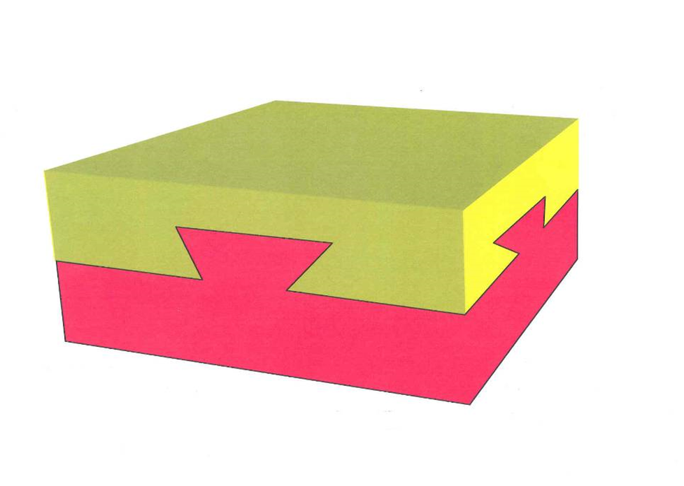
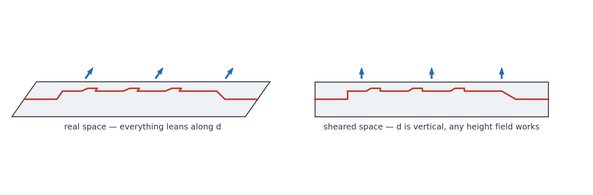
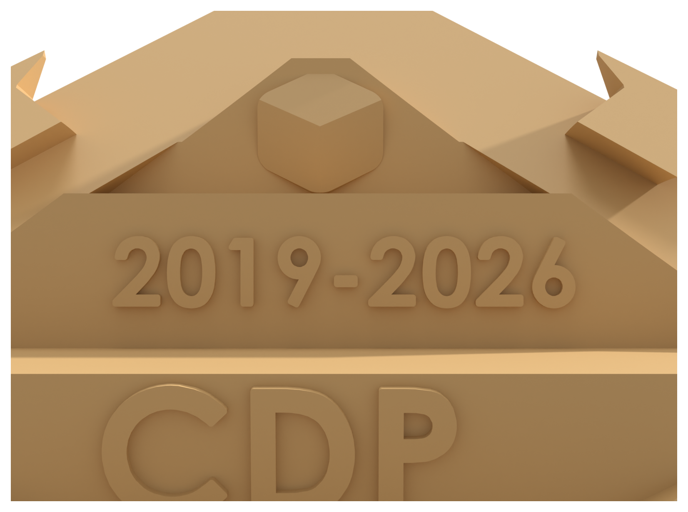
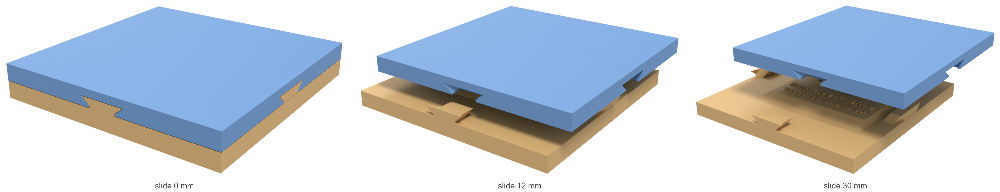
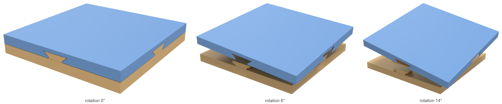
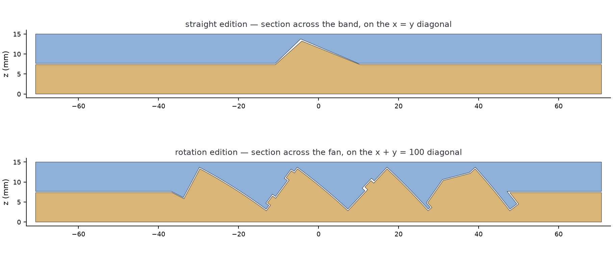
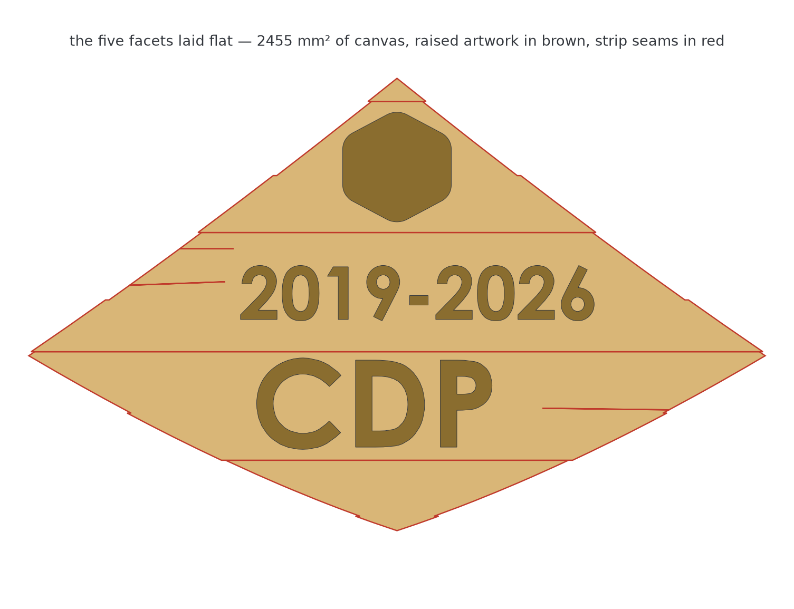
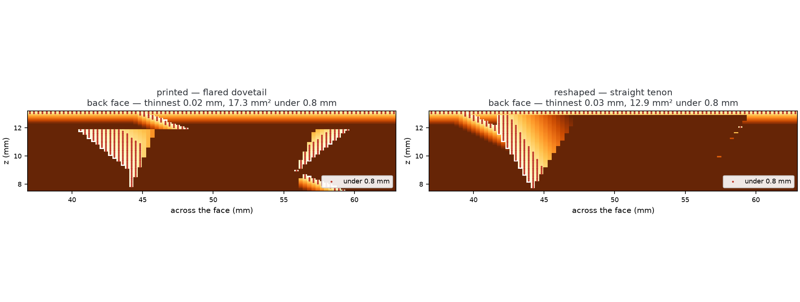

# U3T — the Unnamed 3D Thingy

**A parametric generator, and its own verification suite, for a family of two-part solids that
look impossible from every side and come apart with a single movement.**

> There is a block made of two different kinds of wood, mated so perfectly that there is no air
> between them. From every side the assembly looks exactly the same: a seam at mid-height with a
> small dovetail key in the middle of each face. The two layers can be separated with one simple
> movement — no glue, no springs, no tricks. The same movement puts them back together. How?



The dovetail on the front face says the top cannot be lifted. The dovetail on the side face says it
cannot slide sideways either. Every face you check makes the object more impossible — and yet the
answer is not unique: the puzzle has *infinitely many* solutions, and the interesting ones have
enough room left over to hide a message inside.

This repository holds the code that designs those objects, the code that proves the design is
correct, the print-ready STL files it produces, and the write-ups. The story is told in the
article: [`docs/article/medium-post.md`](docs/article/medium-post.md). The engineering is in
[`docs/The-Unnamed-3D-Thingy.md`](docs/The-Unnamed-3D-Thingy.md).

---

## The idea in one move: shear the world

Suppose the two halves separate by sliding along a fixed oblique direction **d** = (d₁, d₂, 1).
When is a proposed parting surface valid? Change coordinates so that **d** becomes vertical:

```
u = x − d₁·z        v = y − d₂·z        z = z
```



In sheared space the separating motion is straight up, and a surface can be lifted off vertically
**exactly when it is a single-valued height field** — one z per (u, v), vertical cliffs allowed.
So: draw *anything* in the (u, v) plane, extrude it vertically, shear back. The walls come out
parallel to **d** automatically, and the two parts are separable by construction. No angle checks,
no trial and error.

Two consequences fall out of that one sentence:

* **Every side gets its own private groove.** Because **d** has a component along all three axes,
  each face carries an independent ramp instead of two grooves crossing the whole block — so the
  square is not special: any polygon with three or more sides works.
* **The middle of the block becomes free real estate.** Once the perimeter does the puzzle's work,
  the rest of the hidden interface can be arbitrary artwork: a title, a portrait, a QR code.

The first object built this way spent that space on a graduation gift — a title, a subtitle and a
scannable QR code, on a plateau parallel to the top face. It printed, and it was legible, but only
just: a plateau that far from perpendicular to the opening motion foreshortens everything on it,
and relief walls that have to run parallel to **d** make every raised island drift sideways as it
rises. The rotation edition now carries a **sawtooth fan** instead — five facets, each one exactly
perpendicular to the motion — and the resolution problem goes away:



*Five separate strips. Seen along the motion the risers between them are edge-on, so the surface
reads as one continuous page — from that one direction, and no other.*

---

## What is in this repository

```
u3t_generator.py        straight edition: builds both parts, then verifies them
u3t_rot_generator.py    rotation edition: same contract, opens by rotating about an external axis
dfm_scan.py             independent minimum-feature scan (the 0.5 mm FDM rule)
u3t_figures.py          figures for the technical document, straight edition
u3t_rot_figures.py      figures for the technical document, rotation edition

stl/                    the six meshes: two printable pairs, plus assembly-oriented copies
verification/           machine-readable verification reports (JSON), regenerated on every build

docs/
  The-Unnamed-3D-Thingy.md    the full write-up: theory, Fusion walkthrough, generator,
                              verification, printing, and the rotation chapter
  original-design-notes.pdf   the notes the project started from, years before it was finished
  figures/                    figures for the write-up (original/ = extracted from the PDF)
  article/medium-post.md      the article, in Medium's voice
  article/medium-followup.md  the follow-up: what the first printed pair got wrong
  article/images/             their renders (Blender/Cycles) and diagrams (matplotlib)
  templates/                  the five millimetre-true SVG canvases, and the guide to
                              drawing on them

tools/
  facet_templates.py      writes the drawing templates, measured off the built mesh
  svg_content.py          reads artwork back off a template, and checks it is printable
  lockup_layout.py        lays out the shipped lockup across three facets
  fan_figures.py          the sawtooth figures, and the shot list for the render
  key_figures.py          the dovetail wing measured before and after the reshape
  prep_shots.py           poses the verified STLs and emits the shot list
  blender_render.py       headless Cycles renderer for the photographic figures
  postprocess.py          flatten / crop / montage / sanity-check the renders
  diagrams.py             the clean 2D diagrams used by the article
  make_paste_html.py      article markdown -> HTML page you can paste into Medium
  followup_figs.py        the follow-up article's two figures
  extract_pdf_figures.py  re-extracts docs/figures/original/ from the PDF
```

Everything writes into `build/` (git-ignored) except the deliverables — STLs, reports, figures —
which land in their committed locations.

---

## Quick start

```bash
git clone https://github.com/pepistrafforello/U3T.git
cd U3T
python -m venv .venv
.venv\Scripts\activate          # Windows;  source .venv/bin/activate elsewhere
pip install -r requirements.txt

python u3t_generator.py         # straight edition: build + verify        (~15 s)
python u3t_rot_generator.py     # rotation edition: build + verify        (~4 min)
python dfm_scan.py              # minimum-feature scan of all four parts  (~3 min)
```

Each generator writes its STLs to `stl/`, its report to `verification/`, and prints the whole
verification suite as it goes:

```
bottom: watertight=True winding=True bodies=1 volume=80896 mm^3 ... -> PASS
top:    watertight=True winding=True bodies=1 volume=65782 mm^3 ... -> PASS
face fidelity: spread between the four faces 0.001 mm -> PASS
assembled overlap: 0.000000 mm^3 -> PASS
slide along d, t= 0.05: overlap=0.000000 -> PASS
...
slide along d, t=   40: overlap=0.000000 -> PASS
control (straight up), t=1.0: overlap=62.963 mm^3 -> PASS (locks)
control (flat diagonal slide), t=1.0: overlap=344.802 mm^3 -> PASS (locks)
```

Nothing else is needed to print the object — but if you want to regenerate the pictures too, see
[Reproducing the figures](#reproducing-the-figures-and-the-article).

---

## The two editions

Both are 100 × 100 × 15 mm and both show the identical dovetailed seam on all four faces. They
differ in the motion that opens them — which is the point: two objects that are indistinguishable
from the outside and refuse each other's solution — and, now, in what they hide. The rotation
edition carries the [sawtooth fan](#the-hidden-interface-a-sawtooth-fan); the straight edition
carries a single tilted band, blank for the moment, while its content is redesigned.

| | straight edition | rotation edition |
|---|---|---|
| opening motion | translation along **d** = (0.7, 0.7, 1) | rotation of ≈ 12° about an external axis |
| axis / direction | 44.7° off vertical, diagonal in plan | direction (1, 1, 0)/√2 through (65, −65, −103.5) mm |
| walls | planar, parallel to **d** | patches of cylinders coaxial with the axis |
| key | flared dovetail, 6 → 10 mm half-width | flared dovetail, 6 → 8.5 mm half-width |
| hidden interface | one tilted band, 30°, blank | a five-facet fan, 2455 mm², carrying relief |
| process it is built for | FDM, 0.5 mm minimum wall | SLS, 0.8 mm minimum wall |
| generator | `u3t_generator.py` | `u3t_rot_generator.py` |
| print files | `stl/U3T_bottom.stl`, `stl/U3T_top_print.stl` | `stl/U3T_rot_bottom.stl`, `stl/U3T_rot_top_print.stl` |
| report | `verification/verify_report.json` | `verification/verify_report_rot.json` |





The rotation edition needs three placement rules, all of which the generator's geometry satisfies
and the write-up derives:

1. the axis must run **diagonally in plan**, or orbit planes end up parallel to a face and grooves
   surface where they must not;
2. the **apex plane** — the vertical plane through the axis, where orbits turn around — must miss
   the block, otherwise a flat lid is visited twice by the same orbit and the parts jam (this is
   the silent failure that wrecked the original Blender attempt);
3. the axis must sit **far enough away** that every orbit slope stays printable.

---

## The hidden interface: a sawtooth fan

A flat plateau is the wrong shape for a payload, for a reason that has nothing to do with printing:
it sits 44.7° away from perpendicular to the motion. Everything on it is foreshortened, and because
relief walls must run parallel to **d**, a 1.24 mm QR module raised 1.2 mm ends up with 0.05 mm of
itself standing over its own base. Tilting the plane toward perpendicular fixes both — and
immediately runs out of slab, leaving a single band 12 mm wide.

The rotation edition escapes that trade for free. **A plane through the rotation axis is
perpendicular to every orbit it meets**, not merely at one point: its tangent space is spanned by
the axis direction and the radius, and the orbit velocity is perpendicular to both. A facet on such
a plane is therefore exactly normal to the motion *everywhere on it* — no foreshortening, no drift.

And such facets can be stacked. In the unwrapped design plan the interface becomes a descending
staircase in radius: facets at constant phase, separated by risers at constant radius. A riser at
constant radius is a cylinder about the axis, which is swept by orbits — so it is exactly the kind
of cliff "parallel to the motion" that the height-field rule already permits. The result is a
sawtooth, and the whole solid is a union of wedges:

```
bottom solid  =  ⋃ₖ [ cylinder(ρ ≤ ρₖ₊₁) ∩ half-space(φ ≤ φₖ) ]
```



| facet | tilt | strip width | length | canvas | carries |
|---|---|---|---|---|---|
| 1 | 62.0° | 8.5 mm | 41.3 mm | 182 mm² | — |
| 2 | 53.5° | 13.1 mm | 88.6 mm | 876 mm² | the word `CDP`, 10.5 mm cap |
| 3 | 47.0° | 14.4 mm | 88.0 mm | 964 mm² | `2019-2026`, 6.4 mm cap |
| 4 | 41.8° | 15.8 mm | 47.9 mm | 422 mm² | the cube, 13.2 mm |
| 5 | 37.3° | 2.8 mm | 7.0 mm | 10 mm² | — |
| | | | | **2455 mm²** | |

`CANVAS_MAX_LEAN` decides how much of this there is. It trims the footprint at the
radius where a facet would lean past it, and at 50° that left 2614 mm² with a large
flat triangle beside the strips — visible on the open part and easy to mistake for
a mistake. At 62° the fan reaches the whole inset region, 3491 mm² of footprint and
2455 mm² of canvas in five strips. Past about 68° the innermost facets go
near-vertical and the booleans start shedding slivers.

The cube does not go on the widest strip, which looks wrong until you measure it:
these facets are slanted, so a bounding box flatters them badly — one of them is
15.1 mm wide and holds an 8.2 mm circle. `lockup_layout.py` therefore picks the
facet with the largest **inscribed circle** for the cube and the longest remaining
one for the word, and sizes the cube to that circle. It re-picks every run, because
the fan changes shape whenever the axis or the trim angle does.

The radii step by a constant ratio K = (z_hi − z_axis) / (z_lo − z_axis) = 1.0833, which is why the
strips widen across the fan; it is trimmed where a riser would overhang more than
`CANVAS_MAX_LEAN` = 45°, which is also what keeps it printable without supports.

Two properties are worth knowing before drawing anything on it.

* **Depth buys width, not area.** The facet run is Δz / tan φ and the riser run is Δz · tan φ, so the
  share of the footprint that ends up as canvas is cos²φ whatever the depth. Going deeper — the fan
  reaches from z = 4.5 to z = 13.5, *below* the seam as well as above it — buys wider strips and
  nothing else, paid for in floor thickness under the canvas.
* **The seams cost no width.** The risers stand at constant radius, so looking along the opening
  motion they are edge-on. Artwork may run across a seam and will read as continuous — from that one
  direction. From any other angle the surface reads as a louvre and the seams show.

Because the canvas floor at 4.5 mm is below the 7.5 mm seam, the interface can no longer be built
on top of the slab. Within the canvas footprint the slab is cut away and the fan put in its place:

```
L  =  [ (slab ∪ keys) \ curtain ]  ∪  [ (⋃ wedges) ∩ curtain ]
```

where `curtain` is the full-height orbit-swept prism through the canvas footprint — built by the
same `prism()` / `geom_preimage()` pair as everything else, so its walls are parallel to the motion
and its boundary is itself a legal cliff.

### Drawing on it

`docs/templates/` holds five millimetre-true SVG canvases, one per facet, plus a combined sheet
where the five sit in their true relative positions. They are measured off the built mesh, so a
template is exactly the surface that exists — clearance, curtain and angle trim already taken off.

```bash
python tools/facet_templates.py                          # (re)generate the templates
# draw in the `artwork` layer — Inkscape, or anything SVG-native
python tools/svg_content.py docs/templates/facet_3.svg   # check it before building
python u3t_rot_generator.py                              # build the relief
```

[`docs/templates/README.md`](docs/templates/README.md) is the drawing guide: closed filled paths
only, nothing thinner than `MIN_FEATURE`, stay inside the dashed margin. `svg_content.py` checks all
three and catches the "it was all still live text" mistake in a second rather than after a print.
`facet_templates.py` refuses to overwrite a template that has been drawn on unless you pass
`--force`.

The shipped artwork is a lockup laid out across three facets by `tools/lockup_layout.py` — a name
above, a company below, a cube between them. `docs/templates/relief.json` records how high each
piece stands and what shape it is. Those are *nominal* heights, from which the relief keeps the
0.15 mm clearance, so the text specified at 0.8 mm stands 0.65 mm off the built facet and the cube
specified at 3.15 mm apexes at 3.00 mm. The text is flat-topped; the cube's three faces are real
sloped planes meeting at that apex, so it shades like a solid instead of reading as a hexagon.



Two things that shape relief on a surface like this, both learned by getting them wrong:

* **A drawn cube is not a relief cube.** The three lines radiating from the centre of an isometric
  cube are *ridges*, which the pyramid raises by itself. Engraving them as grooves removes exactly
  the apex that sells the shape. The artwork is the plain silhouette; the geometry does the rest.
* **Shading depends on apex ÷ radius, not on apex.** Seen down its diagonal a true cube's near
  corner stands √2 × the silhouette radius proud — 9.4 mm for this 13.3 mm emblem. The first build
  used 0.95 mm, a tenth of that, and it read as a hexagon with a crease. The shipped cube is
  **3.0 mm**, a third of a true one, which tilts the three faces 24.8°, 24.7° and 28.2° and
  separates them under almost any light.
* **Past a point, the outline starts to show.** Only 81 % of this silhouette's perimeter is
  straight; the other 7.6 mm is corner rounding inherited from the drawing, and the radius wanders
  between 5.80 and 6.66 mm. A shallow pyramid hides that. A steep one magnifies it — at a 5 mm apex
  the cap planes cut the rounded corners into visibly curved top edges and the emblem reads as a
  pillow rather than a cube. 3 mm is the most depth this outline carries cleanly; a sharper,
  regular hexagon would carry more.

---

## Design parameters

All of them live at the top of the generators, in millimetres. Change one, re-run, and the whole
object — including its proof — is rebuilt.

| parameter | shipped | meaning |
|---|---|---|
| `L`, `H` | 100, 15 | stock footprint and height |
| `SHX`, `SHY` | 0.7, 0.7 | the separation direction **d** = (`SHX`, `SHY`, 1) |
| `CLR` | 0.15 | clearance per part; total gap between the halves is 0.3 |
| `BAND_Z` | 7.5 | height of the seam on the side faces |
| `KEY_Z0`, `KEY_Z1` | 7.5, 11.5 | bottom and top of the dovetail key |
| `KEY_NECK_Z` | 8.3 | straight neck below the flare (manufacturability, see below) |
| `KEY_HW0`, `KEY_HW1` | 6.0, 10.0 | key half-width at the band and at the top (it flares → undercut) |
| `KEY_RAIL` | 6.0 | how far the internal anchor rail runs in behind each key |
| `MIN_FEATURE` | 0.55 | minimum printable wall/stroke enforced on the interface artwork |
| `PLAT_TILT`, `PLAT_Z_LO/HI` | 30°, 8.5 … 13.5 | straight edition: the single tilted band |
| `CONTENT` | `False` | straight edition: its payload is off while it is redesigned |
| `QR_PAYLOAD`, `TITLE`, `SUBTITLE` | — | that payload's content, for when it comes back |

The rotation edition inherits every one of those and adds its own, at the top of
`u3t_rot_generator.py`:

| parameter | shipped | meaning |
|---|---|---|
| `E`, `C` | (1, 1, 0)/√2 through (65, −65, −103.5) | the rotation axis; apex plane x − y = 130 |
| `KEY_Z0R`, `KEY_Z1R` | 7.0, 13.0 | the key starts *below* the band — see the note on the foot groove |
| `KEY_HW0R`, `KEY_HW1R` | 6.0, 8.5 | waist and flare: 2.5 mm of dovetail wing a side |
| `KEY_NECK_ZR`, `KEY_FLARE_RUN` | 7.7, 4.0 | the flare opens just above the band, over 4 of the key’s 5.5 mm |
| `KEY_RAIL_R` | 8.0 | interior anchor rail behind each key |
| `CANVAS_Z_LO`, `CANVAS_Z_HI` | 3.0, 13.5 | the slice of the slab the fan may use |
| `CANVAS_INSET` | 14.0 | keep the canvas this far from the side faces |
| `CANVAS_MAX_LEAN` | 62.0 | how far inward the fan reaches; it trims the footprint, so it sets how much canvas there is at all |
| `CONTENT_R` | `True` | build the relief from `docs/templates/*.svg` |

Three rules constrain the numbers, and all three were learned the hard way:

* **Depth costs lean.** A key `h` mm tall can protrude at most `lean × h` from the face. A
  near-vertical **d** gives wafer-thin keys no matter how you draw them. At 0.7 the design sits
  right at the 45° overhang limit an FDM printer will bridge without supports — which is exactly
  where you want to be.
* **Anchor whatever the crop can orphan.** Each key continues inward as a solid rail, unioned in
  *before* the stock box crops the leaning prism. Skip this and the visible tabs become watertight,
  collision-free, and attached to nothing.
* **Anchor it on the inboard edge.** As z runs over the key, the side face sweeps a strip of the
  sheared plan — the *face shadow*. Whatever the footprint puts inside that strip is what the face
  shows; whatever it puts beyond it, on the inboard side, is free. So the rail starts at the
  trapezoid edge lying furthest inside the block, and **that is not the same edge on every face**:
  **d** leans into two of them and out of the other two, making it the key waist on one pair and
  the full flare width on the other. Anchor all four on the waist — the obvious reading — and two
  of the keys end up with the flare cantilevered over nothing. That shipped once, and came back
  worn.

### Making your own

For the rotation edition, draw on the templates and rebuild — see
[Drawing on it](#drawing-on-it) above. Nothing in the generator needs editing.

For the straight edition, set `CONTENT = True` and change the strings:

```python
# u3t_generator.py
CONTENT    = True
QR_PAYLOAD = "https://example.com/album"   # shorter URLs -> coarser, easier-to-print modules
TITLE      = "Your Name"
SUBTITLE   = "Your Occasion"
```

then `python u3t_generator.py`. The verification suite re-runs on the new geometry, so a change
that breaks the puzzle property cannot pass silently. For a different polygon, edit the `faces`
table in `key_footprints()` — one entry per side, each with its inward plan direction; the theory
imposes no limit on the number of sides.

---

## Verification: the printed object cannot be flawed by luck

"Be accurate" means *do not trust the construction* — test the meshes that go to the printer. Each
generator attacks its own output before it exits, and writes the results to `verification/`.

| check | straight edition | rotation edition |
|---|---|---|
| bottom part watertight, consistent winding | yes — 80 896 mm³ | yes — 77 420 mm³ |
| top part watertight, consistent winding | yes — 65 782 mm³ | yes — 68 922 mm³ |
| **connected bodies per part** | 1 and 1 | 1 and 1 |
| **the files as written** — re-read from disk | 3 of 3 watertight, 1 body | 3 of 3 watertight, 1 body |
| **face fidelity** — do the four sides really match? | agree to 0.001 mm | agree to 0.005 mm |
| assembly envelope | exactly 100 × 100 × 15 | exactly 100 × 100 × 15 |
| assembled overlap | 0.000000 mm³ | 0.000000 mm³ |
| overlap through the full opening motion | 0.000000 mm³ at 14 stations, t = 0.05 … 40 mm | 0.000000 mm³ at 12 stations, θ = 0.05° … 25° |
| **control** — pull straight up, 1 / 2 mm | collides: 63.0 / 108.5 mm³ | collides: 277.5 / 469.0 mm³ |
| **control** — flat diagonal slide, 1 / 2 mm | collides: 292.5 / 919.7 mm³ | collides: 263.4 / 661.2 mm³ |
| **control** — the *other* edition's move | — | collides: 315.2 mm³ (straight slide, 2 mm) |
| **control** — reverse rotation, 1° | — | collides: 12 696 mm³ |
| thin-feature scan, FDM rule | 15 and 14 patches, 3.3 / 3.7 mm² | 38 and 44 patches, 10.0 / 8.3 mm² |
| thin-feature scan, SLS rule | 36 and 28 patches, 13.6 / 11.2 mm² | 202 and 194 patches, 52.5 / 141.0 mm² |

The control rows are the puzzle property itself, measured rather than asserted: the naive motions
jam, and the one intended motion sweeps through the entire disassembly without ever touching. The
body-count row exists because it once failed — an early draft with a shallower **d** and no anchor
rails produced keys that were watertight, collision-clean, and *detached*. Watertightness says
nothing about a mesh being in one piece; counting connected components does.

The file row is newer, and it is there for the same reason: it failed too. **The mesh in memory and
the file on disk are not the same object.** STL stores float32, whose grid spacing at 100 mm is
about 6 µm, and a boolean kernel leaves the occasional vertex pair half a micron apart — harmless
in double precision. Re-orient such a mesh for printing and those pairs can round onto the same
point, which tears it: the flipped print copy of the rotation top wrote out with six non-manifold
edges while the mesh it was copied from verified watertight, and nothing in the suite noticed.
Both generators now weld coincident vertices before writing (`weld()` in `u3t_generator.py`, which
drops only faces that gain a repeated index — the one removal that cannot open a hole) and then
re-read every file they produced.

---

## Manufacturability

Geometry can be provably correct and still contain features no nozzle can make. After a
manufacturability review flagged two of them, the generators enforce a minimum-feature policy:

* **Asymmetric clearance on the artwork.** A sliding fit does not need the gap split evenly. The
  raised side keeps its full nominal stroke width (never below `MIN_FEATURE` = 0.55 mm) and the
  cavity absorbs the whole 0.3 mm — otherwise the wall left standing between two neighbouring
  letter cavities can shrink to a tenth of a millimetre. Residual sub-minimum necks are removed by
  a morphological opening; sub-minimum walls between adjacent cavities are fused by a closing
  (`clean_thin`, `close_gaps`, `content_offset` in `u3t_generator.py`).
* **A straight neck under every flare.** The key lip starts only above `KEY_NECK_Z`, where its own
  depth already exceeds 0.55 mm, so the overhanging lip never feathers to nothing at its root.

`dfm_scan.py` re-checks this the way a print shop does — slice the part every 0.45 mm, erode each
slice by 0.249 mm, and report whatever disappears:

```bash
python dfm_scan.py
```

For the straight edition both parts come back with nothing worse than 0.27 mm² patches, all of
them where a flared flank runs out into its own side face. Those are corners between two planes the
design fixes — tapering edges of solid material with full thickness immediately behind, a chamfer
rather than a wall. They print as a slightly rounded lip and every flush dovetail in this family
has them.

It is worth being precise about that claim, because an earlier version of this file made it about a
feature it did not fit. The first printed pair had, on two of its four keys, a 0.2 mm ledge running
16 mm across with *nothing* behind it — a cantilever, not a chamfer — and it wore in service. The
scan had reported it, at 2.55 mm² per patch, and it was waved through under the sentence above.
Re-anchoring the rails (the third design rule) replaced it with 6.2 mm of solid material and took
the bottom part from 15.21 mm² of thin features to 3.31 mm². The threshold in `dfm_scan.py` is now
0.10 mm², low enough that nothing in that class can be mistaken for a chamfer again.

The rotation edition had the same defect, and worse: its faces disagreed by 0.93 mm. It now
carries the rule too. Because its design plan comes from a bend map rather than a shear, the
inboard direction there cannot be read off a normal vector — it is measured, by pre-imaging a point
on the face and the same point 1 mm inside it. The rule then picked the **front and right** faces
for flare-width anchoring, which are exactly the two `dfm_scan.py` had flagged, arrived at
independently. Face spread 0.93 mm → 0.008 mm.

The fan and the relief standing on it bring their own entries to that scan: 45 patches on the
rotation bottom part and 65 on the top, against 15 and 14 for the straight edition. They fall into
three classes, and each one has to be argued rather than counted.

* **Glyph corners and the rim of the pyramid**, 0.1–0.9 mm² each, ~8 mm² in total. These are the
  outlines of the relief caught at a height where the slice clips a corner. Behind each is the full
  0.65 mm of text or up to 3.0 mm of cube, standing on a solid facet.
* **Key flanks running out into their own face**, 0.27–0.40 mm² — the same chamfer corners the
  straight edition has.
* **The ridge where the innermost facet meets its riser**: three patches of 18–37 mm² in the top
  part's very first slice, at z = 4.93. That one is large enough to deserve a second look, and it
  got one. The facet and the riser meet at an interior angle of **87–90°** — a right-angle ridge,
  not a wall. It runs 75 mm horizontally, parallel to the axis, which is exactly why a *horizontal*
  slice through it is long and thin while a slice across it is a solid wedge. In the print file that
  ridge is the highest point of the part, laid down last on top of the material that supports it.

What is left, then, is in every case the corner where one surface runs out into another. Sample the
material behind a key-flank patch and it grows 0.16 → 1.35 mm over a couple of millimetres of
width: a solid wedge, which is what a chamfer is. That test — *is there material behind it* — is
the one worth running on anything a thin-feature scan reports, and it is the test the shipped ledge
would have failed.

### The second print failure: a rule belongs to the process, not the design

The rotation pair was ordered in **SLS** nylon, and came back with two of its four
keys incomplete. The supplier's note was exact:

> the wall thickness of the tongue-and-groove feature is insufficient for
> manufacturing … For the SLS process, the minimum required wall thickness is
> 0.8 mm.

Everything in this repository had been verified to `MIN_FEATURE` = 0.55 mm, which
is the FDM rule. **The band between 0.5 and 0.8 mm was invisible to every check
here**, and that is exactly where the keys lived. `dfm_scan.py` now scans at both
rules and prints them side by side, because the number is a property of the
machine and not of the drawing.

The feature that failed is specific, and worth naming. A flared dovetail widens as
it rises; the extra width on each side is a **wing**. On two of the four faces
nothing backs that wing but the *face shadow* — the strip of the design plan the
side face sweeps as z runs over the key (the same shadow that drives the third
design rule above). A wing at lateral offset *w* first exists at the height where
the flare reaches *w*, and from there its depth grows at the lean, about a third of
a millimetre per millimetre of height:



So a wing needs **2.4 mm of key above it** to reach 0.8 mm, and the key is 5.5 mm
tall in total. Opening the flare sooner only moves the problem outward; opening it
abruptly makes it worse, because then the whole wing is shadow rather than rail.
Measured across the obvious parameter space, no flare clears 0.8 mm on those two
faces, at any numbers this axis allows.

The flare therefore had to go *at that axis*. The rotation key became
**straight-sided**, with the undercut carried by the lean alone. Three things
improved at once:

| | flared dovetail | straight tenon |
|---|---|---|
| thinnest material behind a key face | **0.04 mm** | **0.85 mm** |
| back face, area under 0.8 mm | 17.3 mm², two broad wedges | 8.2 mm², two edge slivers |
| face fidelity | 0.008 mm | **0.000 mm** — the four faces are now identical by construction |
| lock against a straight lift, 1 mm | 68.7 mm³ | **87.1 mm³** |
| lock against the straight edition's slide, 2 mm | 216.9 mm³ | **287.2 mm³** |

With the axis later moved (next section) the flare came back; what follows
described the straight-sided interim. What is left under 0.8 mm on a key is a
sliver about half a millimetre wide along its two vertical edges, where a wall parallel to the motion meets the face
at an oblique angle. That is a corner between two solid surfaces, not a wall: the
material behind it grows immediately, and SLS renders it as a slightly rounded
edge. It is the same class of feature that printed correctly on all four FDM parts
and on two of the four SLS keys.

### A groove at the foot of two keys

pepi spotted a thin horizontal line along the foot of two of the four keys, on the
open part, and it had been there from the beginning. It is a real notch, 0.45 mm
deep and 0.3 mm tall, and it comes from the clearance being taken in two places
that disagree at the seam:

```
the band slab's top drops to   BAND_Z - CLR = 7.35
the key's trapezoid foot lifts to KEY_Z0R + CLR = 7.65
```

Between those two heights the face belongs to neither, and on the two faces whose
orbits leave through them the prism behind it sits inboard — so the face is cut
back. The other two are flush, which is why it showed on exactly two keys.

The fix is to start the key below the band (`KEY_Z0R` 7.5 → 7.0) so the offset
cannot open the strip; the extra trapezoid is simply absorbed into the slab, which
is the same material. The notch measures 0.000 mm on all four faces afterwards and
nothing else moves: overlap still 0.000000 mm³, face fidelity 0.005 mm, the lock
within 0.2 mm³ of where it was.

It is worth noting what did *not* catch this. Every check in the suite is about
the mesh being valid, the halves separating, the faces agreeing with each other,
or features being thick enough. A 0.45 mm notch present identically on two faces
passes all of them. It took someone looking at the thing.

### Getting the dovetail back: move the axis, not the key

Removing the flare made the part buildable and cost the object its premise. A
rectangular tab does not say *this cannot be lifted*; a dovetail does, and every
face saying so is the whole trick. So the next question was whether the flare
could be made thick enough instead of deleted — and it can, but only by moving the
axis, because of a conservation law that is worth stating plainly:

```
canvas strip width  x  key wing thickness rate  =  fan depth / sqrt(2)
```

Both come from the same angle φ about the axis. The plan displaces `tan φ` per mm
of height, which is what thickens the wing; a facet's horizontal run over a depth
Δz is `Δz / tan φ`, which is the strip. **You cannot thicken the dovetail without
narrowing the canvas**, at a fixed fan depth — and no key *profile* trades between
them, only the axis does. That is why none of the profile changes worked.

The apex plane therefore came in from `x − y = 210` to `x − y = 130`, which doubles
the rate, and the fan went from 9 to 10.5 mm deep to buy back part of the strip.
The orbits are now ~26° off horizontal, far past anything FDM would bridge
unsupported; in a powder bed that costs nothing.

Two things had to be repaired to get there, both of which had been silently
relying on the old shallow lean:

* **The anchor rail stopped nesting.** It was pre-imaged at the *offset*
  trapezoid's edge, so the two halves' rails sat `2·CLR` apart in height and
  therefore `2·CLR·lean` apart in plan. That is 0.2 mm at the old axis, which
  nested; 0.4 mm the wrong way at the new one, which put **5.8 mm³ of the bottom
  part inside the top** on two of the four keys while every other check passed.
  Both rails now start on the shrunken trapezoid's edge, so they nest by
  construction, and each keeps its own width.
* **`weld()` was being applied unconditionally on export.** It is a repair, and
  snapping to the float32 grid can fuse vertices from different sheets and pinch a
  mesh that was already sound — which it did to every grid phase once the fan's
  facets came close to tangent. The export now checks the written file first.

What it bought, measured against the pair that came back from SLS:

| | printed | now |
|---|---|---|
| key profile | dovetail 11.7 → 19.1 mm, over 65 % of the height | dovetail 11.7 → 16.7 mm, over 67 % |
| widening, as a share of the key's height | 65 % | **67 %** |
| thin-feature scan, SLS rule, bottom | 87.5 mm² | **52.5 mm²** |
| thin-feature scan, SLS rule, top | 180.6 mm² | **141.0 mm²** |
| lock against a straight 1 mm lift | 68.7 mm³ | **277.5 mm³** |
| canvas | 3553 mm² in five facets | 2455 mm² in five |

And what it cost, stated plainly: **the canvas halved**, which is the conservation
law being paid rather than a mistake, and the content came down with it — from a
three-part lockup to a cube, the dates `2019-2026` and `CDP`, one to a facet.

Measured face-on with rays rather than by slicing, every key improves:

| face-on, under 0.8 mm | printed | now |
|---|---|---|
| back / left (the two that failed) | 17.3 / 16.9 mm² | **12.9 / 12.9 mm²** |
| front / right | 11.4 / 10.7 mm² | **8.1 / 8.2 mm²** |
| all four | 56.2 mm² | **42.1 mm²** |

One wrong turn is worth recording, because it was wrong twice and I shipped the
claim before checking it. Reasoning that a wing needs height above it to thicken,
I opened the flare abruptly — over 0.5 mm of the key's 5.5. That makes the key a
rectangle with a lip at its foot: the width climbs over **5 %** of the key's
height, so there is no dovetail left to see, and quoting its 11.7 → 16.7 mm as
proof of one is just wrong. It did not even help. The thin band follows the flare
line whichever way it is drawn, and slanting it makes it *narrower*: at this axis
a 4 mm flare run leaves 5.6 mm² of wing under 0.8 mm against 7.6 mm² for the
abrupt one. The flare now runs over 4 mm, and the key looks like what it is.

---

## Printing and assembly

* **Files** — print `stl/U3T_bottom.stl` as oriented and `stl/U3T_top_print.stl` (already flipped
  exterior-side-down); or the `U3T_rot_*` pair for the rotation edition. `U3T_top.stl` and
  `U3T_rot_top.stl` are the assembly-oriented copies, for CAD and inspection.
* **Process.** The straight edition is drawn for **FDM** and prints well in PLA. The rotation
  edition is drawn for **SLS** — its key was reshaped to clear SLS's 0.8 mm minimum wall, and the
  powder bed needs no supports at all. Either part will print on either machine; only the minimum
  feature differs, and `dfm_scan.py` reports both.
* **No supports.** The leaning walls sit at 44.7°, right at the classic FDM limit; the fan's risers
  are trimmed at 45° for the same reason; every relief faces up on the bed in the print files.
  SLS needs none of this, but costs nothing by it.
* **Settings** — PLA, 0.2 mm layers (0.12 mm makes crisper relief), 3 perimeters, ≥ 15 % infill.
  Enable elephant-foot compensation (~0.1 mm) or deburr the first-layer edges: the band and the
  side faces have to mate flush.
* **Fit** — the 0.3 mm total gap is a snug sliding fit on a well-tuned printer. If it binds, sand
  lightly or rebuild with `CLR = 0.20`; for a loose demonstration fit use `CLR = 0.25`.
* **Assembly** — rest the top over the bottom offset by about +10 mm in x and y and lower it along
  the diagonal; it seats flush in one push. The rotation edition takes the same single move as a
  swing rather than a slide: about 12° about an axis running diagonally, well outside the block.
  Either way, because the lean breaks the square's symmetry, **only one of the four orientations
  engages** — the solver has to find the motion *and* the orientation.
* **The reveal** — the interface reads best under a point source rather than diffuse room light.
  The cube's three faces are tilted 24.8°, 24.7° and 28.2° in three different directions, which a
  raking beam separates and flat light flattens back into a hexagon. Seen along the opening motion
  the five strips line up into one page — that is the view worth handing someone. If you put a QR
  code back on it, a soft pencil rubbed flat across the module tops makes it scan instantly.

---

## Reproducing the figures and the article

The diagrams are matplotlib; the photographic figures are rendered headlessly in **Blender 5.x**
with Cycles, which has to be installed separately and reachable as `blender`.

```bash
python tools/diagrams.py                  # the 2D diagrams -> docs/article/images/
python tools/prep_shots.py                # pose the STLs -> build/posed, build/shots.json
blender -b --factory-startup -noaudio --python tools/blender_render.py -- \
        build/shots.json build/render_raw
python tools/postprocess.py               # flatten, crop, montage, check -> docs/article/images/
python tools/make_paste_html.py           # -> build/medium-post-paste.html
python u3t_figures.py                     # technical-document figures -> docs/figures/
python u3t_rot_figures.py
```

The sawtooth figures are a separate, shorter pass, because the shot that shows the interface has to
be framed on whatever is actually drawn on the templates:

```bash
python tools/key_figures.py               # the key's wing, before and after
python tools/fan_figures.py --shots       # frame the shot -> build/shots_readme.json
blender -b --factory-startup -noaudio --python tools/blender_render.py -- \
        build/shots_readme.json build/readme_raw
python tools/fan_figures.py               # sections, canvas, and the render, flattened
```

`postprocess.py` finishes with an automated check on every emitted image (minimum width, and a
non-white content fraction inside sane bounds) and prints `BAD: none` when they all pass.
`make_paste_html.py` produces a local page whose rich-text copy-paste lands cleanly in Medium's
editor, images included.

---

## Documentation

| document | what it is |
|---|---|
| [`docs/The-Unnamed-3D-Thingy.md`](docs/The-Unnamed-3D-Thingy.md) | the complete write-up: the original notes, the proof, a step-by-step Autodesk Fusion walkthrough, the automated pipeline, the verification suite, printing, and the rotation edition |
| [`docs/article/medium-post.md`](docs/article/medium-post.md) | the same story told as an article, for readers rather than builders |
| [`docs/article/medium-followup.md`](docs/article/medium-followup.md) | the follow-up: the two keys the first printed pair got wrong, and the rule that was missing |
| [`docs/templates/README.md`](docs/templates/README.md) | how to draw on the five canvases: tools, format, and the rules the relief imposes |
| [`docs/original-design-notes.pdf`](docs/original-design-notes.pdf) | where it began: the unfinished notes, kept for provenance |

---

## Tested environment

Python 3.11.5 on Windows 11, with the versions pinned as comments in
[`requirements.txt`](requirements.txt). The heavy lifting is done by
[`manifold3d`](https://github.com/elalish/manifold) (guaranteed-watertight booleans),
[`trimesh`](https://github.com/mikedh/trimesh) and [`shapely`](https://github.com/shapely/shapely).
Nothing in the pipeline is platform-specific; the only external program is Blender, and only for
the figures.

## License

Apache License 2.0 — see [`LICENSE`](LICENSE). A small number of screenshots inside the original
design notes are third-party material and are excluded from that grant; they are itemised in
[`NOTICE`](NOTICE), together with the acknowledgements this project owes.

*The object still has a dovetail on every face, a motion nobody can see, a name hidden in the
middle — and, after all this time, no name of its own.*
