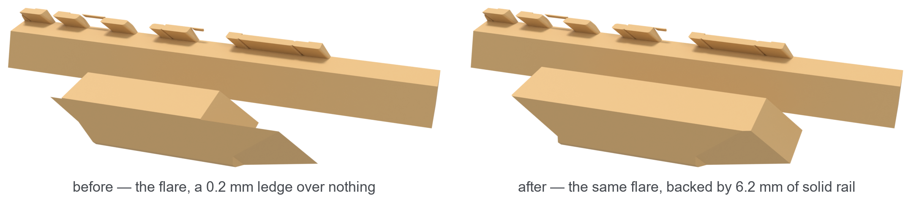
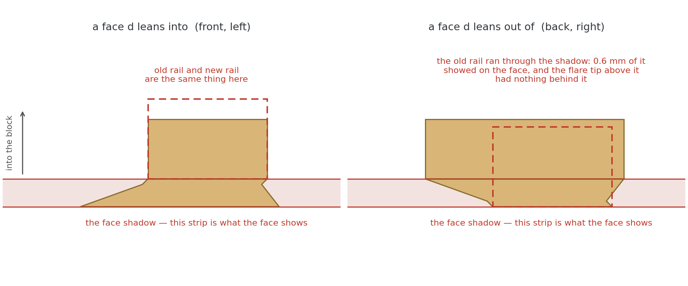
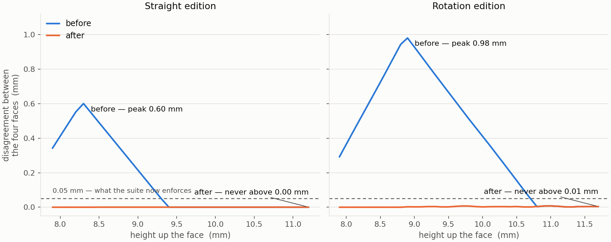
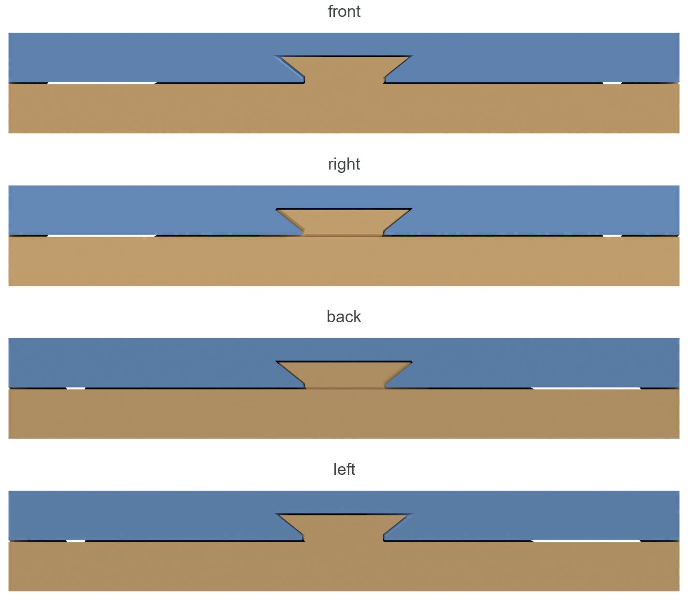

# The Thing About Verification Is That It Only Checks What You Doubted

## My own scan found the flaw. I read the number, wrote a paragraph explaining why it was fine, and shipped it anyway

A while ago I wrote about a puzzle that had been living rent-free in my head for
years — a block of two woods, mated so perfectly there is no air between them, showing the same
dovetail on all four faces, that nonetheless comes apart in one movement. The story of how it got
solved, generalised into an infinite family, and finally turned into a printable object with a QR
code hidden inside is here: [**The Unnamed 3D Thingy**](https://medium.com/@pepi.strafforello/the-unnamed-3d-thingy-16e8ca82ebd0).

*The object, for anyone arriving here first. All four sides look like this. The dovetails
say you cannot lift it; the puzzle says otherwise.*

That one ended on a satisfied note. Two verified editions, every check green, a graduation gift
four years late and provably correct.

Then I had it printed in PLA, gave it away, and afterwards looked at the object properly.

Two of the four dovetails were wrong. Not broken — the block mates, opens, does the trick. But
where two of the keys should have had a solid flared lip, there was something closer to a blade:
thin enough that you could see it was not going to survive being handled. The other two were
exactly as drawn.

Two of four. That asymmetry is the whole story.

---

## What was actually wrong

The object separates by sliding along an oblique direction **d** = (0.7, 0.7, 1). That direction
leans *into* two of the four faces and *out of* the other two. I knew that; it is the reason the
puzzle works at all. What I had not thought through is that it also means the four keys are not
built by the same process — they only look as though they are.

Each key is a little leaning prism, and the outer face of the block crops it. On the two faces
**d** leans into, the crop leaves the key's root intact. On the other two, it slices the key almost
tangentially, and what survives is a flared lip with nothing whatsoever behind it. I measured it on
the mesh I had sent to the printer: **0.20 millimetres thick, running 16 millimetres across, a
cantilever over air.**

*The same key, from inside the block. On the left, what I printed: the flare is a blade. On the right, what it should have been.*

Here is the part I would rather not write. My verification suite *had* found this. The
minimum-feature scan I built after a print shop caught two other problems reported these exact
patches, at 2.55 mm² apiece, on exactly those two faces, weeks before any of this. I looked at the numbers, decided they were
the tapering edges where a dovetail flank meets a flat face — a chamfer, harmless, present in every
joint of this kind — and wrote a paragraph to that effect. In an email. To the print shop. Asking
them not to worry about it.

The paragraph was well argued and completely wrong. A chamfer is a taper with solid material behind
it. This was a taper with nothing behind it. The difference is invisible in a thin-feature report,
which tells you how thin something is and not what is underneath it, and I never asked the second
question because I already had an answer I liked.

---

## The rule I should have had

The fix turned out to be one sentence of geometry, which is the annoying thing about it.

The whole design is built in *sheared* coordinates — the trick from the first story, where you
shear space until the separation direction stands vertical and any height field you draw becomes a
valid parting surface. In that sheared plan, as you move up the key from the seam to its top, the
side face of the block sweeps across a strip. And:

> **Anything the design puts inside that strip is what the face shows. Anything beyond it, on the
> inboard side, is invisible from outside and therefore free.**

So the internal rail that anchors each key — the beam that keeps the visible tab from being a
free-floating wafer — must start at whichever edge of the key lies furthest *inside* the block.
From there it can be any width you like. Not one millimetre outboard of it.

And that edge is not the same one on every face.

*The same key seen in the sheared plan, on the two kinds of face. Left: the rail starts at the key's waist, which is what I had. Right: it has to start at the flare's top edge instead — and my rail ran straight down through the strip.*

My code anchored all four rails on the key's base edge. On two faces that is exactly right. On the
other two it is exactly wrong, and it fails twice over: the flare is left standing on air, *and*
the rail itself pokes out through the surface of the face.

Which brings me to the thing I found while checking the fix, and which bothers me more than the
worn dovetails.

---

## The four faces were never identical

The entire premise of this object — the reason it is a puzzle and not a box with a seam — is that
all four sides look the same. Every check I had written tested that the two halves separate
without touching, that each is one watertight solid, that the naive movements jam. Not one of them
tested the thing the object is *for*.

So I wrote that check: slice the finished part at each face and compare the dovetail outlines. On
the straight edition the four faces disagreed by up to **0.56 mm**. On the curved edition — the one
that opens with a rolling twist about an axis 15 cm outside the block — they disagreed by **0.93
mm**.

Just under a millimetre. Nobody who handled it ever noticed, and I had looked at that object for
months. But it was there in the geometry the whole time, and the only reason I found it is that I
went looking for something else.

*How far apart the four faces put the dovetail outline, height by height. The hump is the anchor rail surfacing where it should not. The dashed line is the tolerance the suite now enforces.*

---

## The fix, and doing it twice

Moving the anchor to the inboard edge is a small change — a few lines that pick an edge instead of
assuming one. What it buys:

- solid material behind the full width of the flare: **0.20 mm → 6.20 mm**
- worst thin patch on the part: **2.55 mm² → 0.27 mm²**
- total thin features: **15.21 mm² → 3.31 mm²**
- face disagreement: **0.56 mm → 0.001 mm**
- the key's bearing face, the surface that actually takes the push: **roughly doubled**

And nothing whatsoever about the outside of the object changes, which is the entire point. The
material that was added lives in the region the faces cannot see.

*After. The same four faces, which is what they were supposed to be all along.*

Then I carried the rule over to the curved edition, and this was the part I enjoyed. That one is
not built with a shear but with a bend map — vertical design lines become circular orbits around
the external axis — so "inboard" is not a direction you can read off a normal vector. You have to
measure it: pre-image a point on the face, pre-image the same point one millimetre inside, and take
the difference.

With that in hand the rule ran and chose two faces for flare-width anchoring. They were the same
two faces the thin-feature scanner had flagged, arrived at from completely
independent directions — one from a rule about what a face can see, the other from eroding sliced
polygons by a quarter of a millimetre. When two unrelated methods point at the same two faces out
of four, you can stop worrying about whether you have understood the problem.

Face spread on the curved edition: 0.93 mm → 0.008 mm. Worst patch: 1.55 mm² → 0.40 mm².

What remains on both editions, at a quarter of a square millimetre a patch, genuinely *is* the
chamfer I claimed the other thing was. I know because this time I checked what is behind it: sample
inward from the face and the material grows from 0.16 mm to 1.35 mm over a couple of millimetres.
A solid wedge. That test — **is there anything behind it?** — is the one I should have run the
first time, and it takes about four lines of code.

---

## What I actually take from this

I have written a fair amount of verification in my life and I thought the lesson of the first story
was a good one: don't trust the construction, test the artefact. Watertight is not the same as in
one piece. Verified is not the same as manufacturable.

The lesson of this one is narrower and more uncomfortable. A verification suite is a record of
everything you once thought to doubt. It grows one entry at a time, each added the day something
went wrong, and it is therefore *exactly* shaped like your past mistakes and blind to the rest. The
object's defining property had no test because it had never occurred to me that it could fail. It
could not fail — it was the premise.

And when the suite did produce a number I did not like, I wrote prose at it. That is the part worth
watching for. Reasoning and measuring feel identical from the inside; the difference is that one of
them can be wrong in a way that sounds excellent.

The blocks are corrected, both editions, and the code, the printable files, the full write-up and
the verification logs are all at
[github.com/pepistrafforello/U3T](https://github.com/pepistrafforello/U3T). The dovetails are
crisp, the four faces now match to a thousandth of a millimetre, the hidden QR code still scans —
and the thing still, after all this time, has no name.
